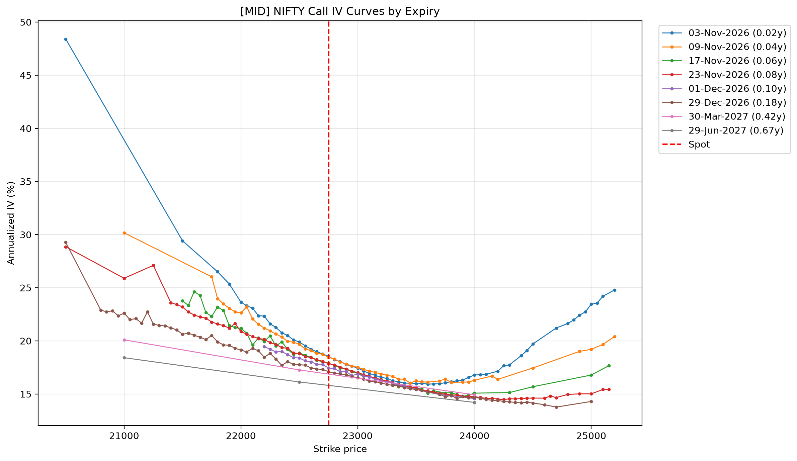
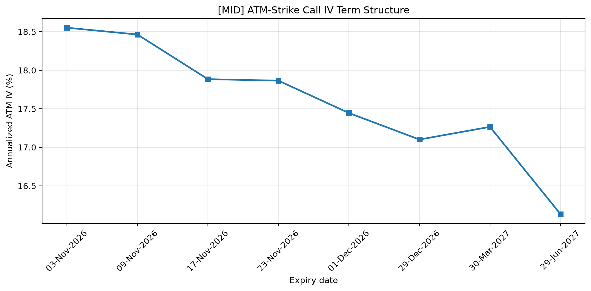
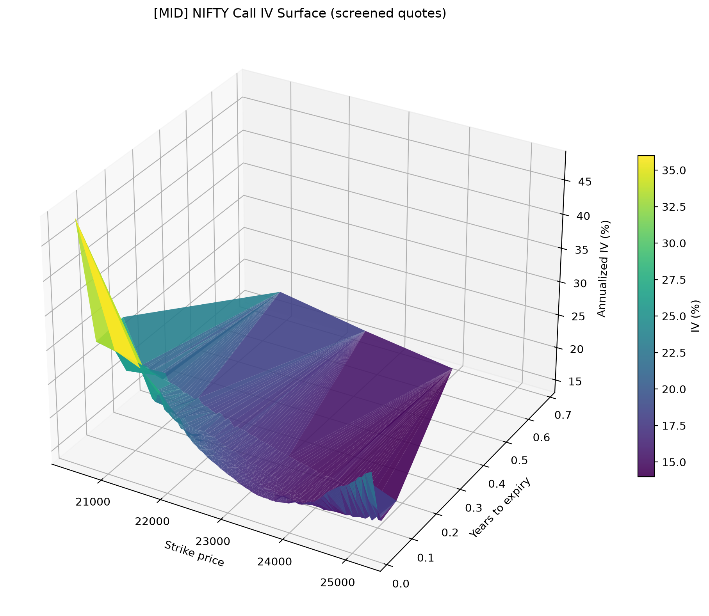
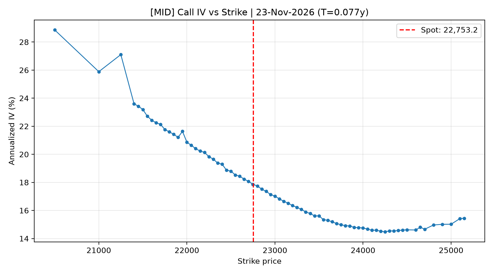
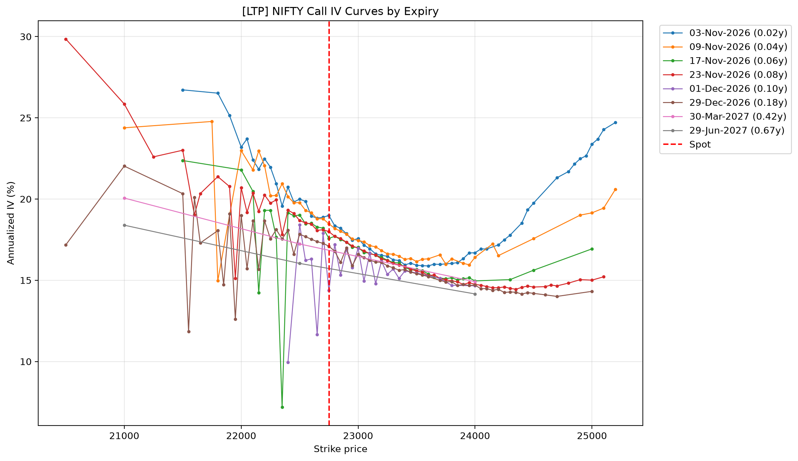

# NIFTY 50 Options: Implied Volatility Estimation and Surface Analysis

**Dividend-adjusted Black–Scholes pricing · Newton–Raphson · NSE option-chain data · Volatility smile and term structure**

An exploratory quantitative finance project that calculates annualized **call-option implied volatility (IV)** from real NIFTY 50 option-chain CSV exports. It compares two market-price inputs—**bid–ask midpoint** and **last traded price (LTP)**—and builds screened strike/maturity visualizations with documented limitations.

**[Read the formal project report (PDF)](docs/reports/NIFTY_Options_IV_Formal_Project_Report.pdf)**

> **Dataset provenance:** Eight NSE option-chain CSV exports collected **26 October 2026 at 15:40 IST** (user-reported download time), covering expiries from **3 November 2026** to **29 June 2027**. The scripts model the price snapshot at **15:30 IST**; these times are not equivalent, and quote-level update timestamps are not available in the exports.

## Key results

| Metric | Observation |
|---|---:|
| Raw strike rows across eight expiry CSVs | **648** |
| Strike rows selected within ±12% of spot | **592** |
| Midpoint observations accepted for plots | **355 / 592 (60.0%)** |
| LTP observations accepted for plots | **312 / 592 (52.7%)** |
| Median absolute IV difference, jointly accepted pairs | **0.10 percentage points** |
| Accepted LTP observations outside displayed bid–ask | **95 / 312 (30.4%)** |

The midpoint-based nearest-available-strike call IV generally decreases from **18.55% (3 Nov 2026)** to **16.13% (29 Jun 2027)**. Longer-dated observations are sparse (only three accepted strikes for each March and June 2027 expiry), so interpret that comparison cautiously.

At the **22,750 call strike, 1 Dec 2026**, the displayed midpoint was **₹549.925** and LTP was **₹463.35**, which correspond to **17.44%** and **14.38%** IV. The LTP was below the displayed bid. This illustrates why last-traded prices can create misleading dips in a current quote-based volatility curve; such a difference does *not* prove the trade itself was incorrect.

## Selected Plots

### Implied Volatility Smiles — Midpoint


### ATM Implied Volatility Term Structure


### 3D Implied Volatility Surface


### Individual Volatility Smile — 23 November 2026


### Implied Volatility Smiles — LTP



## Methodology

**Dividend-adjusted Black–Scholes:**

```text
Call = S * exp(-q*T) * N(d1) - K * exp(-r*T) * N(d2)
d1   = (ln(S/K) + (r - q + 0.5*sigma^2)*T) / (sigma*sqrt(T))
d2   = d1 - sigma*sqrt(T)
```

The project inverts a quoted call premium into the volatility parameter `sigma` using **Newton–Raphson**, with **Brent's method** as a safe fallback. It rejects invalid theoretical prices and unresolved roots instead of inventing zero IV values.

| Model parameter | Current setting | Interpretation |
|---|---|---|
| `SPOT_PRICE` | `22753.2` | Assumed index level for analysis |
| `RISK_FREE_RATE` | `0.061` | Constant 6.1% annual risk-free-rate proxy |
| `DIVIDEND_YIELD` | `0.0152` | Constant 1.52% annual continuous dividend-yield proxy |
| `SNAPSHOT_DATETIME` | `2026-10-26 15:30` | Assumed *model* quote time (IST) |
| `STRIKE_RANGE_PCT` | `0.12` | Only consider strikes within ±12% of spot |
| `MAX_RELATIVE_SPREAD` | `0.20` | Maximum accepted relative spread |
| `MIN_VEGA_FOR_PLOT` | `20.0` | Minimum Vega for plotted rows |
| `MAX_IV_FOR_PLOT` | `1.00` | 100% annualized plotting threshold |

All market values, failed inversions, and screening statuses are saved to CSV for audit. The quality thresholds above are **project heuristics**, not official NSE rules.

## Project structure

```text
nifty-options-iv-analysis/
├── black_scholes.py
├── implied_volatility.py
├── analyze_options_mid.py
├── analyze_options_ltp.py
├── requirements.txt
├── .gitignore
├── data/
│   ├── __init__.py
│   ├── fetch_mid_data.py
│   ├── fetch_ltp_data.py
│   └── option-chain-ED-NIFTY-*.csv     # locally downloaded; ignored by Git
├── docs/
│   └── figures/                       # selected committed figures
├── plots_mid/                         # generated charts, CSV and optional HTML
└── plots_ltp/                         # generated charts, CSV and optional HTML
```

## Run locally (Windows PowerShell)

Requirements: **standard Windows CPython 3.13** recommended; a virtual environment; locally obtained NSE CSV files. An MSYS2/MinGW Python environment may not accept ordinary Windows NumPy wheels.

```powershell
py -3.13 -m venv .venv
.\.venv\Scripts\Activate.ps1
python -m pip install -r requirements.txt
```

Place each expiry-specific NSE CSV in `data/` without renaming the `DD-Mon-YYYY` portion. Then review the model constants at the top of **both** analysis scripts before running:

```powershell
python analyze_options_mid.py
python analyze_options_ltp.py
```

Outputs include individual IV-by-strike charts, combined smile charts, ATM-strike term structure PNG/CSV, `calculated_iv_diagnostics.csv` and a static 3D surface PNG

## How reliable are the results?

- The analysis uses **calls only**; market interpretation would benefit from OTM put quotes and put–call parity checks.
- One constant interest-rate and dividend-yield proxy is used across expiries.
- Quote screens remove obvious issues but cannot certify liquidity, quote freshness, or absence of arbitrage.
- March and June 2027 have only **three accepted strikes each** in the ±12% window; connecting those points is for visualization, not calibrated smile estimation.
- The triangulated surface is **not** a smooth or arbitrage-free fitted volatility model.
- IV is a model-implied premium parameter, **not** a guaranteed realized-volatility forecast or a trading recommendation.

## Future work (not yet implemented)

1. Compare **OTM calls and puts** and validate put–call parity.
2. Use **forward moneyness**, maturity-aligned rates, and tighter quality diagnostics.
3. Extend to **historical/realized volatility** using daily NIFTY returns and compare matching horizons with implied volatility.
4. Study surface smoothing / no-arbitrage validation and changes across multiple trading dates.

## Data source and references

- [NSE India — Option Chain](https://www.nseindia.com/option-chain) (original expiry-specific CSV downloads, collected 26 October 2026, also finding the Dividend Yield).
- [Financial Benchmarks India Pvt. ltd MIBOR rate](https://www.fbil.org.in/#/home) (For Term MIBOR rate, collected 19 October 2026 data)
- Black, F. & Scholes, M. (1973), *The Pricing of Options and Corporate Liabilities*.
- Merton, R. C. (1973), *Theory of Rational Option Pricing*.
- Hull, J. C., *Options, Futures, and Other Derivatives*, 11th ed.
- [SciPy `brentq`](https://docs.scipy.org/doc/scipy/reference/generated/scipy.optimize.brentq.html).

**Educational / research project. Not investment advice.** Raw CSVs should only be redistributed if the applicable source terms allow it.
